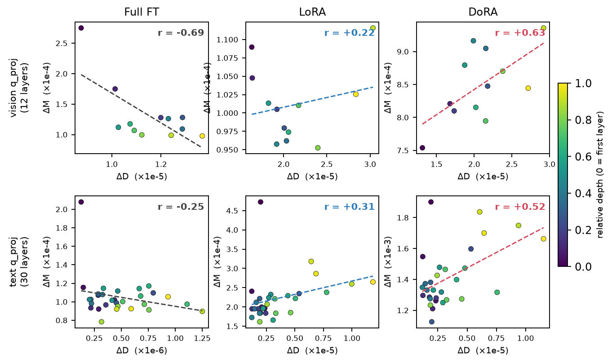

# Part 1: Does DoRA's magnitude–direction claim transfer to a small VLM?

## 1. Central claim of the paper

DoRA (Liu et al., 2024) splits each pretrained weight matrix into a **magnitude** vector and a **direction** matrix. It trains the magnitude directly and updates the direction with LoRA. The authors claim this makes the low-rank update learn like full fine-tuning (FT), so DoRA beats LoRA at the same rank with no extra inference cost.

## 2. Chosen concept and its evidence

The claim rests on the paper's **weight-decomposition analysis** (Sec. 2.2, Fig. 2). For a weight <i>W</i> with per-unit norm <i>m</i> = ‖<i>W</i>‖, the change from the pretrained <i>W</i>0 is measured as:

- **Magnitude change:** ΔM = meann |mnt − mn0|
- **Direction change:** ΔD = meann (1 − cos(Wnt, Wn0))

These are plotted for the query matrices of every layer at several training checkpoints.

- **FT and DoRA: negative slope.** Layers that change direction a lot change magnitude little, and the reverse.
- **LoRA: positive slope.** Magnitude and direction change in proportion. The authors read this as LoRA being unable to make the subtle, decoupled updates FT makes.

That analysis used VL-BART with a **frozen** visual encoder, so the image side of the model was never examined.

## 3. Hypothesis translated to vision–language

When SmolVLM is fine-tuned on document VQA, the paper's pattern should hold:

- **Full FT and DoRA:** negative ΔM–ΔD correlation across layers.
- **LoRA:** positive correlation.

This should hold in the language model **and** in the vision encoder, which the paper never adapted. Accuracy should rank DoRA ≥ LoRA. The test is the **sign of the correlation**, not accuracy.

## 4. Experimental setup

- **Model:** SmolVLM-256M-Instruct, 256M parameters:
  - SigLIP vision encoder, 12 layers;
  - pixel-shuffle connector;
  - SmolLM2-135M language model, 30 layers.

  It is the recommended default, and SmolVLM is strong on OCR-style input.
- **Data:** DocVQA (`HuggingFaceM4/DocumentVQA`).
  - Train split: **2000** examples.
  - Validation split: **300** examples.
  - Both drawn by shuffled streaming with seed 42.
  - Images resized to a longest edge of 1024 px, to keep text readable and fit the T4.

  Document VQA needs both towers: the vision encoder must read small print, and the language model must pick out the answer span.
- **Targets (identical for all methods):**
  - the q, k, v and o projections of both towers, plus the connector;
  - **169 matrices** in total: 48 vision, 1 connector, 120 text.
- **Methods:**
  - **LoRA and DoRA:** peft with `use_dora` off or on; r = 8, α = 16, dropout 0.05, lr 1e-4; about 1.6M and 1.7M trainable parameters.
  - **Full FT:** all parameters trained at lr 1e-5.
  - **Shared training settings:** AdamW, cosine schedule with 5% warm-up, batch 8 (2 × 4 accumulation), 1 epoch = 250 steps, fp16 autocast with GradScaler, gradient checkpointing, gradient clipping at 1.0.
  - **Loss:** on answer tokens only.
- **Hardware and checkpoints:** Colab T4; each run checkpointed to Google Drive.
- **Claim metric:**
  - **Snapshots:** ΔM and ΔD (per output unit, as in peft's DoRA) recorded for all 169 matrices at 8 evenly spaced checkpoints. For DoRA and LoRA, <i>W</i> is the merged weight.
  - **Metric used:** Pearson *r* between ΔD and ΔM **across layers at the final checkpoint**, for each tower and projection.
  - **Why not the pooled correlation:** pooling over checkpoints, as the paper's figure does, measures time here. In a 250-step run every layer's ΔM and ΔD grow together (mean per-layer *r* over time ≥ 0.97 for every method), which swamps the between-layer pattern.
- **Accuracy:** ANLS (the DocVQA metric) and exact match, with greedy decoding up to 24 tokens. Differences are tested with a paired bootstrap (5000 resamples).

## 5. Results

**Baseline vs. adapted.**

| Model | ANLS | Δ vs zero-shot [95% CI] | EM | EM, trailing "." ignored | Train time |
|---|---|---|---|---|---|
| Zero-shot | 52.2 | — | 25.7 | 43.0 | — |
| LoRA | 56.7 | +4.6 [+0.7, +8.5] | 46.0 | 47.0 | 18 min |
| **DoRA** | **57.5** | **+5.3 [+1.3, +9.3]** | **46.3** | 46.7 | 26 min |
| Full FT | 57.1 | +4.9 [+0.0, +9.8] | 45.0 | 45.7 | 18 min |

- **Fine-tuning helps every method.** Much of the exact-match gain is answer format: the zero-shot model ends answers with a period.
- **DoRA vs LoRA is within noise:** +0.8 ANLS [−0.6, +2.2], better on 10 questions and worse on 5. It also costs 45% more training time.

**Claim test.** The table gives Pearson *r* across layers at the final checkpoint; Spearman ρ is in brackets. The paper predicts FT < 0, LoRA > 0 and DoRA < 0.

| Tower / module | Full FT | LoRA | DoRA | Matches paper? |
|---|---|---|---|---|
| vision q_proj (12 layers) | **−0.69** (−0.50) | +0.22 (−0.10) | +0.63 (+0.52) | FT yes; DoRA **no** |
| vision k_proj | −0.67 (−0.06) | +0.80 (+0.59) | +0.67 (+0.64) | FT weakly; DoRA no |
| vision v / o_proj | +0.85 / +0.86 | +0.31 / +0.93 | +0.06 / +0.70 | no (all positive) |
| text q_proj (30 layers) | **−0.25** (−0.20) | +0.31 (+0.48) | +0.52 (+0.34) | FT yes; DoRA **no** |
| text k / v / o_proj | −0.08 / −0.04 / +0.56 | +0.47 / +0.19 / +0.44 | +0.64 / +0.33 / +0.36 | mixed |

<b>Figure 1.</b> ΔM against ΔD for the query projection of each layer at the final checkpoint (step 250). Colour shows layer depth. Full FT has the negative slope the paper reports. DoRA has the same positive slope as LoRA, in both the vision encoder (top) and the language model (bottom).

**Interpretation.**

- **The FT and LoRA half of the claim transfers** for the query projection, the matrix the paper analyses:
  - FT is negative in both towers. It is strongest in the vision encoder, where ρ = −0.50 and *r* = −0.41 with layer 0 removed.
  - LoRA is positive.
- **The DoRA half does not.** In every q and k projection DoRA's sign is positive, like LoRA's. In both towers its per-layer pattern follows LoRA, not FT. Its answers do too: DoRA gives the same answer as LoRA on 265 of 300 questions, but the same as full FT on only 147.
- **DoRA does decouple the two components, but only in scale.** For about the same ΔD as LoRA (3.1e-5 vs 3.1e-5 in the vision encoder), DoRA moves magnitude **8×** more (8.8e-4 vs 1.0e-4). The learned magnitude vector absorbs a uniform per-layer rescale, but it does not produce FT's trade-off between layers.
- **Outside q and k the signs are mixed** for every method, including FT's positive v and o projections. So the clean negative slope looks specific to the query and key projections, not a general property of FT.
- **Verdict:** the hypothesis is **partly refuted**. In SmolVLM, DoRA reproduces neither FT's ΔM–ΔD pattern nor a reliable accuracy gain.

## 6. Bonus: the vision encoder adapts by rotating, not rescaling

The per-tower numbers show something specific to the vision side. Under full FT, the **relative direction change in the vision encoder is 32× larger than in the language model** (ΔD 1.4e-5 vs 4.4e-7), while the magnitude change is about the same (1.1e-4 vs 0.9e-4). With the low-rank methods the gap is 8×. The negative FT slope is also clearest in the vision encoder.

One reading:

- SigLIP was pretrained on natural images.
- Document pages at 1024 px are far from that distribution.
- So adapting the encoder means **re-orienting** its query and key features toward small glyphs and layout, not rescaling them.

This is exactly the regime where DoRA's separate direction update should matter most, and where the paper never looked.

**Tower ablation (causal test).** DoRA was retrained with the same settings on **one tower only**, with the connector frozen:

| DoRA targets | Trainable | ANLS | Δ vs all-tower DoRA [95% CI] | Vision ΔD | Text ΔD |
|---|---|---|---|---|---|
| Both towers + connector | 1.7M | 57.5 | — | 3.1e-5 | 3.9e-6 |
| Vision encoder only | 0.6M | *pending* | *pending* | *pending* | — |
| Language model only | 1.0M | *pending* | *pending* | — | *pending* |

*Ablation interpretation: pending (results arrive after the Colab run).*

## 7. Limitations

- **One seed and one short run** (250 steps). The paper trains far longer, and DoRA's negative slope may need more steps to emerge.
- **Scaling:** ΔD grows with the square of the update size and ΔM grows linearly, so different matrices sit at different scales. This is why correlations are reported per projection.
- **Learning rate:** FT uses a 10× smaller learning rate than the adapters, a standard but uncontrolled choice.
- **Sample size:** 12 vision layers give wide intervals on each *r*.
- **Code:** `part1_vlm_dora/` (`dora_vlm.py` and `run_colab.ipynb`) reproduces every number. Figures come from `report/make_p1_figs.py`.
